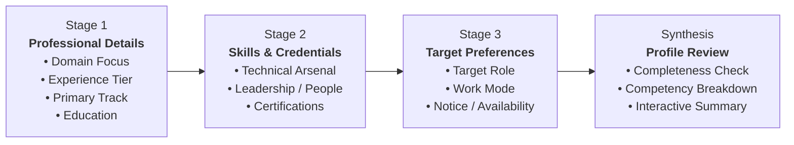

<div align="center">

# ✦ Resume Skill Analyser ✦

**A high-precision editorial workspace for synthesizing professional profiles, mapping core competencies, and charting your next career milestone.**

[](#)
[](#)
[](#)
[](#)
[](#)
[](#)
[](#)

<p align="center">
  <a href="#-overview">Overview</a> •
  <a href="#-key-features">Key Features</a> •
  <a href="#-the-3-stage-analysis-flow">Analysis Flow</a> •
  <a href="#-design-system--optical-refraction">Design & Optics</a> •
  <a href="#-project-structure">Project Structure</a> •
  <a href="#-quickstart--development">Quickstart</a> •
  <a href="#-quality--verification">Quality Suite</a> •
  <a href="#-optional-code-graph">Code Map</a>
</p>

---

</div>

## 📖 Overview

**Resume Skill Analyser** is a standalone, client-side web application crafted with **React 19**, **Vite 8**, and **Tailwind CSS v4**. Built with an editorial _“printed annual”_ visual direction and an _“accent ladder”_ hierarchy, it guides candidates through a structured, multi-dimensional assessment of their career capabilities without requiring an active backend or transmitting sensitive personal data.

The workspace pairs a thoughtful 3-stage profile synthesizer with an advanced **Liquid Glass** optical refraction engine, seamless theme transitions, and buttery Lenis smooth scrolling.

> [!NOTE]
> All profile generation, validation, and review steps execute entirely in-memory within your browser. No backend connections or third-party tracking services are invoked.

---

## ✨ Key Features

| Capability                         | Highlights                                                                                                                                  |
| :--------------------------------- | :------------------------------------------------------------------------------------------------------------------------------------------ |
| **🎯 3-Stage Career Synthesizer**  | Structured data entry spanning Domain Expertise, Verified Skills, and Role Targets with instantaneous synthesis and review.                 |
| **🔮 Liquid Glass Optical Engine** | Adaptive SVG displacement mapping adapted from `liquid-glass-js`, delivering realistic edge refraction with zero-overhead CSS fallback.     |
| **🌓 Dynamic Dual Theme**          | Deep Royal Purple & Soft Lavender palette with pre-render FOUC avoidance, cross-tab synchronization, and native `color-scheme` integration. |
| **🌊 Fluid Physics & Motion**      | Native-feeling momentum scroll via Lenis, React 19 `ViewTransition` route changes, and asynchronous background floating folds.              |
| **♿ Inclusive & Accessible**      | Semantic landmarks, accessible modal dialogs with focus trapping and scroll locks, keyboard-navigable comboboxes, and skip navigation.      |
| **⚡ High-Speed Tooling**          | Sub-second cold starts powered by Vite 8, warning-free checks via Oxlint, and zero-LLM local AST code graphing with Graphify.               |

---

## 🔄 The 3-Stage Analysis Flow

The workspace coordinates profile creation through a unified `ProfileDraftProvider` context, safeguarding work across route visits while providing real-time validation at every checkpoint.



1. **Stage 1: Professional Details** — Establishes industry foundation, seniority echelon, specialization track, and highest credential.
2. **Stage 2: Skills & Credentials** — Captures technical tooling and interpersonal competencies with searchable pill selectors and credential tags.
3. **Stage 3: Target Preferences** — Gathers target career objectives, preferred workplace arrangements (Remote, Hybrid, On-site), and availability windows.
4. **Synthesis & Review** — Aggregates all selections into a presentation-ready review panel with validation indicators and inline edit shortcuts.

---

## 🎨 Design System & Optical Refraction

The user experience centers around an editorial Royal Purple and Lavender design language documented in [`DESIGN.md`](DESIGN.md).

### Color Palette

| Token Role         | Light Mode | Dark Mode | Usage Description                                       |
| :----------------- | :--------: | :-------: | :------------------------------------------------------ |
| **Ground**         | `#F7F4FA`  | `#17111F` | Viewport backdrop and deepest canvas layer              |
| **Paper**          | `#FFFFFF`  | `#221A2D` | Elevated surfaces, cards, and dialogue containers       |
| **Reading Text**   | `#2E1A47`  | `#F7F4FA` | High-contrast editorial titles and primary copy         |
| **Muted Text**     | `#695675`  | `#C0B1CF` | Subtitles, labels, helpers, and secondary metadata      |
| **Primary Action** | `#2E1A47`  | `#B8A1D9` | Brand pills, primary CTA buttons, and active indicators |

### Optical Glass Architecture

The optical refraction engine (`src/Components/UI/liquid-glass/`) adapts physical lens mechanics from [dashersw/liquid-glass-js](https://github.com/dashersw/liquid-glass-js):

- **Chromium Engines**: Generates dynamic SVG displacement filters across element backdrops, producing organic distortion along rounded contours (up to 8px displacement radius).
- **Other Browsers**: Gracefully degrades to frosted glass utilizing backdrop filters and high-specular highlights.
- **Visual Preference Modes**:
  - `Full Effects`: Active dynamic SVG refraction and animated backdrop folds.
  - `Device Settings`: Respects user `prefers-reduced-motion` and `prefers-reduced-transparency` system settings.
  - `Reduced Effects`: Flattens materials to high-contrast opaque surfaces with immediate transitions.

---

## 📁 Project Structure

```text
Resume-Skill-Analyser/
├── public/                     # Static assets & pre-render scripts
│   ├── effects-init.js         # Early effect preference loader
│   ├── theme-init.js           # Head-injected FOUC prevention script
│   └── favicon.svg             # Rising-strokes brand symbol
├── scripts/
│   └── graphify-hooks.mjs      # Git hook installer & local AST graph updater
├── src/
│   ├── App.jsx                 # Route definitions, transitions & layout shell
│   ├── main.jsx                # Application entrypoint & DOM mounting
│   ├── index.css               # Design tokens, typography & foundational styles
│   ├── liquid-glass.css        # Glass materials, scenery & fold animations
│   ├── appearanceTransition.js # Smooth, interruptible theme transition helper
│   ├── visualEffects.js        # Effect tier manager & cross-tab store
│   ├── useTheme.js             # Theme state subscriber (light / dark)
│   ├── Components/
│   │   ├── Analyze/            # 3-Stage synthesizer, review, context & state
│   │   ├── Home/               # Hero banner, sample profiles & feature highlights
│   │   ├── Settings/           # Visual effect toggles & real-time theme previews
│   │   ├── AboutUs/            # Philosophy, architecture & workflow walkthrough
│   │   ├── SignIn-SignUp/      # Accessible authentication interfaces & validation
│   │   ├── NavBar/             # Accessible floating bar with mobile modal dialog
│   │   ├── Footer/             # Responsive glass footer with disclosure note
│   │   └── UI/                 # Brand symbols, scenery & liquid-glass adapter
│   └── hooks/                  # Smooth scroll, route focus & scroll reveals
├── tests/                      # Regression suite for state, theme & optical rules
├── DESIGN.md                   # Visual specification & accessibility rationale
├── package.json                # Project dependencies & operational scripts
├── vite.config.js              # Vite bundler configuration with Tailwind plugin
└── .oxlintrc.json              # Oxlint linting rules and overrides
```

---

## 🚀 Quickstart & Development

### Prerequisites

Ensure you have **Node.js 22.22.0** or higher installed on your system.

```sh
node --version # Should output >= v22.22.0
```

### 1. Clone & Install Dependencies

```sh
git clone https://github.com/Visagan/Resume-Skill-Analyser.git
cd Resume-Skill-Analyser
npm ci
```

### 2. Start the Development Server

```sh
npm run dev
```

Open [http://localhost:5173](http://localhost:5173) in your browser to explore the workspace.

---

## 🧪 Quality & Verification

A robust quality suite guarantees styling consistency, lint standards, and regression safety:

```sh
# Run the complete test, lint, format, and production build check
npm run check
```

Or run targeted commands as needed:

| Command                | Action                                                                                |
| :--------------------- | :------------------------------------------------------------------------------------ |
| `npm run lint`         | Runs **Oxlint** across all source, public, test, and script files (`--deny-warnings`) |
| `npm run format:check` | Verifies code styling via **Prettier**                                                |
| `npm run format`       | Auto-formats maintained files according to `.prettierrc.json`                         |
| `npm test`             | Executes native Node.js unit tests (`node --test`) for state and appearance           |
| `npm run build`        | Compiles an optimized production bundle into `dist/`                                  |
| `npm run preview`      | Locally serves the production distribution bundle                                     |

---

## 🗺️ Optional Code Map

This repository supports local, AST-extracted codebase intelligence powered by [Graphify](https://github.com/graphifyy):

```sh
# 1. Install Graphify in your Python environment
python -m pip install graphifyy

# 2. Extract local AST graph (no LLM / API key required)
graphify extract . --code-only

# 3. Query architecture & relationships
graphify query "How do appearance preferences update the interface?"
```

### Automated Git Hooks

Keep your local code graph continuously up to date on `git commit` and `git push`:

```sh
npm run graph:hooks
```

To trigger an on-demand update:

```sh
npm run graph:update
```

> Output is stored locally in the ignored `graphify-out/` folder and is never checked into source control.

---

## 📜 License & Attributions

This project is open-source and released under the [MIT License](LICENSE).

- **Optical Refraction Mechanics**: Adapted from [dashersw/liquid-glass-js](https://github.com/dashersw/liquid-glass-js). The original MIT license and copyright notice are preserved in [`src/Components/UI/liquid-glass/LICENSE`](src/Components/UI/liquid-glass/LICENSE) and published at `/licenses/liquid-glass-js.txt`.
- **Typography**: Manrope and DM Sans are distributed under the SIL Open Font License.

---

<div align="center">

Crafted with care & precision ✦ Designed for clarity.

</div>
